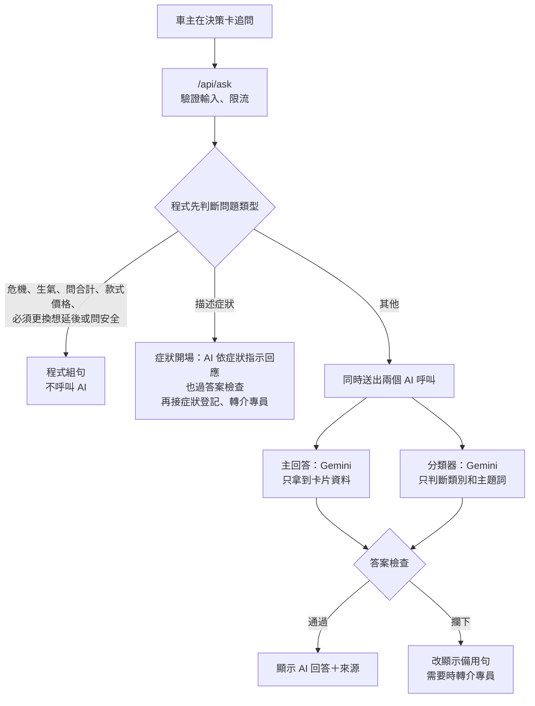

# Trust Intelligence 維修決策卡

TOYOTA 和泰汽車黑客松決賽作品。車主回廠保養時，用手機看懂維修建議，自己決定今天換什麼。

**一句話：結論由規則決定，AI 只負責解釋，程式再檢查 AI 說的話。**

- 正式站：https://toyota-trust-intelligence-mvp.vercel.app
- 實測紀錄頁：https://toyota-trust-intelligence-mvp.vercel.app/eval

## 目錄

- [1 分鐘看懂](#1-分鐘看懂)
- [頁面與功能](#頁面與功能)
- [要背的數字](#要背的數字)
- [技術棧](#技術棧)
- [系統架構](#系統架構)
- [資料夾結構](#資料夾結構)
- [API](#api)
- [本機開發](#本機開發)
- [環境變數](#環境變數)
- [測試](#測試)
- [部署](#部署)
- [安全與隱私](#安全與隱私)
- [規劃、還沒做的](#規劃還沒做的)
- [名詞](#名詞)
- [開發規則](#開發規則)
- [狀態與授權](#狀態與授權)

## 1 分鐘看懂

主角是王先生：剛過保固，在意價格。他不是不願意修，是無法判斷該不該修。

1. **技師檢查**：技師在技師頁輸入量測值，例如煞車來令片 2 mm、輪胎胎紋 2.5 mm。
2. **規則判斷**：規則引擎依安全門檻給每個檢查項目一個結論：必須更換、可延後、目前不用換。AI 不能改結論。
3. **AI 解釋**：車主在決策卡上追問，AI 只能引用卡片上的資料回答，並附上來源。
4. **程式檢查**：AI 的回答送到車主面前前，程式先核對。說錯就攔下，改顯示正確的固定句；碰到安全、議價、要改結論，就轉介專員。

## 頁面與功能

| 頁面 | 網址 | 給誰看 | 做什麼 |
|---|---|---|---|
| 首頁 | `/` | 評審 | 進入王先生、林小姐兩台示範車 |
| 維修決策卡 | `/card/wang` | 車主 | 三種結論、量測與照片、量測趨勢、AI 追問、車主偏好、回廠提醒、交車說明 |
| 技師頁 | `/tech/wang` | 技師、專員 | 接待摘要、輸入量測值（結論當場重算）、檢查結果摘要、真實攔截重播 |
| 實測紀錄 | `/eval` | 評審 | 真實 Gemini 連跑的每一題問題、回答、檢查結果 |

林小姐的車把網址的 `wang` 換成 `lin`。

**現場示範「不是寫死的」**：開 `/tech/wang`，把輪胎胎紋改成 1 mm。結論重算，輪胎變成必須更換。

## 要背的數字

都有紀錄檔可查。

| 數字 | 意思 | 紀錄在哪 |
|---|---|---|
| 417 次攻擊，違規 0 | 其他 AI 扮演奧客出題攻擊（紅隊）：單輪 182 題、多輪 76 組 235 輪。想騙它改結論、打折、保證安全，全部守住 | `docs/eval/redteam/run_2026-11-10_final.md`、`multi_2026-11-10_final2.md` |
| 87 / 87 | 自己的 29 題追問考卷，用真實 Gemini 連跑 3 次全過 | `docs/eval/raw/2026-11-10_final_run1..3.log`，`/eval` |
| 18 / 18 | 檢查結果摘要（王先生、林小姐各 3 次 × 3 輪）全部通過答案檢查 | 同上 |
| 平均 0.8 秒 | AI 回應時間。被問就說「中位數約 1 秒」 | `/eval` |
| NT$0.18 | 每台車 AI 成本（1 次摘要＋3 題追問，含分類器）。大廠一個月約 NT$67 | `docs/eval/cost.md` |

**為什麼是 29 題**：考卷有 31 題，其中 2 題是預設按鈕，不呼叫 AI。題目從 21 題加到 25 題（車主偏好），再加到 29 題（輪胎款式）。

**被問「零違規能保證安全嗎？」**：不能。這只代表這個版本守住這批攻擊。所以高風險問題由程式組句，其他回答由程式核對，說錯會攔下。

## 技術棧

| 層 | 技術 | 版本 | 用途 |
|---|---|---|---|
| 前端框架 | Next.js（App Router） | 16.3.6 | 頁面和 API 放在同一個專案，一次部署 |
| UI | React | 19.2.8 | 決策卡、技師頁的互動 |
| 語言 | TypeScript | 5 | 結論、來源代號都有型別，改錯會在編譯時發現 |
| 樣式 | Tailwind CSS | 4 | 手機版面 |
| 後端 | Next.js Route Handler（Node.js runtime） | — | `/api/ask` 一支 API |
| AI 模型 | Google Gemini `gemini-3.5-flash-lite` | — | 追問、分類器、檢查結果摘要；直接呼叫 REST API，沒有用 SDK |
| 測試 | Vitest | 4 | 單元測試、真實 AI 實測、紅隊 |
| 程式檢查 | ESLint（eslint-config-next） | 9 | 程式風格與常見錯誤 |
| 部署 | Vercel | — | 正式站 |
| 資料 | 程式內的示範資料、瀏覽器 localStorage | — | 沒有資料庫、沒有登入 |

沒有資料庫、沒有登入是 MVP 的取捨：示範資料寫在程式裡，評審打開網址就能用。執行時只依賴 `next`、`react`、`react-dom` 三個套件。

## 系統架構

### 三層分工

| 層 | 誰負責 | 做什麼 | 不能做什麼 |
|---|---|---|---|
| 判斷 | 規則引擎（`rules.ts`） | 量測值對安全門檻，給出結論 | — |
| 解釋 | Gemini | 用白話解釋結論、回答追問，附來源代號 | 產生或改變結論、報新價格、保證安全 |
| 檢查 | 答案檢查（`ask.ts`） | 核對 AI 回答的來源、結論說法、金額 | — |

### 一題追問怎麼走



重點：

- **結論永遠由規則重算。** 技師改量測值時，前端把新數值送到 API，API 用規則引擎重算結論，再交給 AI。AI 拿到的是算好的結論。
- **AI 只看得到卡片上的資料。** 提示詞只放這台車的檢查項目、量測趨勢、行車摘要、原廠文件片段，AI 必須用來源代號引用。
- **高風險問題不經 AI。** 危機、生氣、問合計金額、必須更換卻想延後或問安全，都由程式組句子。描述症狀時，AI 只做開場（接住狀況、說今天的檢查判斷不了原因），之後的症狀登記題組由程式問。
- **答案檢查擋什麼**：來源代號不存在；必須更換被說成可延後；可延後被說成正常；答應議價或打折；保證安全的字眼；卡片外的金額。
- **AI 失敗或逾時**：顯示備用句，不顯示錯誤畫面。Gemini 回 503 或 429 時會短暫重試。
- **提示詞不進前端。** 前端和後端共用的值放在 `askShared.ts`，前端不 import `ask.ts`。

### 不經 AI 的部分

接待摘要、交車說明、回廠提醒、症狀登記、專員建議說法，全部由規則產生。只有「追問」和「檢查結果摘要」呼叫 AI。

### 資料從哪來

- **示範車資料**：`src/lib/vehicles.ts`。兩台車（王先生、林小姐）的檢查項目、量測值、價格、照片都是假設資料，沒有資料庫。
- **原廠文件片段**：`src/lib/manual.ts`。照抄比賽提供的《TOYOTA 回廠服務流程手冊》與官網公開的 COROLLA CROSS 車主手冊，附頁碼。
- **車主偏好**：存在車主這支手機的瀏覽器（localStorage）。長期偏好以車主為鍵；本次情境以這次工單為鍵，換工單就不沿用。正式版規劃改由專員確認後寫回和泰車主檔。
- **實測紀錄**：`/eval` 讀 `docs/eval/raw/` 和 `docs/eval/redteam/` 的紀錄檔產生頁面。

## 資料夾結構

```text
src/
  app/
    page.tsx              首頁
    card/[id]/            維修決策卡（車主）
    tech/[id]/            技師頁（技師、專員）
    eval/                 實測紀錄頁
    api/ask/route.ts      唯一的 API：追問、檢查結果摘要、模擬竄改
  lib/
    rules.ts              規則引擎：量測值 → 結論（唯一能決定結論的地方）
    vehicles.ts           兩台示範車的資料、輪胎款式、價格
    card.ts               檢查項目轉成卡片顯示；套用技師改的量測值
    ask.ts                追問流程：組提示詞 → 呼叫 AI → 答案檢查 → 決定顯示什麼
    askShared.ts          前後端共用的值（危險徵兆字詞、對話記憶上限）
    answers.ts            來源代號、常見問題按鈕的預寫回答
    manual.ts             原廠文件片段
    gemini.ts             呼叫 Gemini、短暫重試
    intake.ts             症狀登記題組（只在瀏覽器執行）
    preferences.ts        車主偏好的題目與說法
    preferenceStore.ts    車主偏好存取（localStorage）
    reception.ts          接待摘要
    handover.ts           交車說明、專員建議說法
    flow.ts               流程面板（AI 怎麼被檢查）
    replay.ts             真實攔截重播的紀錄
    dealer.ts             在原廠做的差別（示意）
    rateLimit.ts          /api/ask 限流
    visitor.ts            每個瀏覽器的隨機訪客 id（限流用）
    evalLog.ts            解析實測紀錄給 /eval
    *.test.ts             單元測試
scripts/
  測試題_追問AI.md         29 題追問考卷
  eval21.eval.ts          真實 Gemini 跑考卷
  redteam*.ts             紅隊（單輪、多輪）攻擊與檢查
  cost.eval.ts            成本實測
docs/
  eval/                   全部實測紀錄（README.md 有每一輪的說明）
  demo-storyboard.md      Demo 影片分鏡
  agents/                 AI 開發助手的設定
public/photos/            檢查項目照片
GLOSSARY.md               名詞定義
```

## API

只有一支：`POST /api/ask`。

請求（JSON）：

| 欄位 | 必填 | 說明 |
|---|---|---|
| `vehicleId` | 是 | `wang` 或 `lin` |
| `question` | 追問時必填 | 200 字以內 |
| `history` | 否 | 車主前幾題的原文，最多 3 題（不含 AI 回答） |
| `measurements` | 否 | 技師改過的量測值；API 會用規則引擎重算結論 |
| `preferences` | 否 | 車主偏好 |
| `summary` | 否 | `true` 時產生檢查結果摘要，不需要 `question` |
| `simulate` | 否 | `"tampered"` 時模擬 AI 回答被竄改，不呼叫 AI |

標頭 `x-visitor-id`：瀏覽器的隨機訪客 id，用來限流。

回應：成功時回傳回答、來源、是否轉介專員、答案檢查結果和流程紀錄。錯誤時回傳 `{ "error": "給車主看的說明" }`：

| 狀態碼 | 意思 |
|---|---|
| 400 | 輸入格式不對（問題太長、量測值或偏好格式錯） |
| 404 | 找不到這台車 |
| 429 | 問太快，被限流 |
| 502 | AI 呼叫失敗 |
| 503 | 伺服器沒設定 API key |

## 本機開發

需要 Node.js（建議 20 以上）。

```bash
npm install
npm run dev
```

打開 http://localhost:3000 。

沒有 API key 時，畫面、規則和常見問題按鈕照常運作；AI 追問會顯示「AI 暫時無法回答」，請車主點常見問題或找專員。

## 環境變數

放在專案根目錄的 `.env.local`。這個檔案不會進 git。

| 變數 | 必填 | 說明 |
|---|---|---|
| `GEMINI_API_KEY` | AI 功能需要 | Google Gemini API key |
| `GEMINI_MODEL` | 否 | 預設 `gemini-3.5-flash-lite` |
| `ASK_LIMIT_PER_IP_PER_MINUTE` | 否 | 每個 IP 每分鐘可問幾次，預設 300。決賽現場多人共用 Wi-Fi，所以設得寬；每個訪客另有每分鐘 20 次的上限 |

## 測試

| 指令 | 做什麼 | 要 API key |
|---|---|---|
| `npm test` | 全部單元測試（37 個測試檔），不呼叫真的 AI | 否 |
| `npm run lint` | ESLint 檢查 | 否 |
| `npm run eval:21` | 用真實 Gemini 跑 29 題考卷和檢查結果摘要 | 是，會花一點費用 |
| `npm run eval:cost` | 實測每台車的 AI 成本 | 是 |

單元測試涵蓋：規則引擎、答案檢查（每條規則都有不該攔的反例）、程式組句、限流、偏好存取、實測紀錄解析。

真實 AI 每次回答都不一樣，所以實測連跑多次，用通過率說話，不挑最好的一次。所有紀錄都在 `docs/eval/`，包含沒過的輪次。

## 部署

正式站在 Vercel。用 Vercel CLI 部署到正式環境：

```bash
vercel deploy --prod
```

Vercel 專案的環境變數要設定 `GEMINI_API_KEY`。

## 安全與隱私

- API key 只放在伺服器的環境變數，不進 git，不送到前端。
- 不收集個人資料。訪客 id 是瀏覽器自己產生的隨機字串，只用來限流。
- 車主偏好只存在車主自己的瀏覽器。
- 限流計數放在伺服器記憶體。這是 MVP 的簡化：Vercel 多個實例各算各的。正式上線要改用 KV（例如 Upstash Redis）。

## 規劃、還沒做的

被問到時照實說「這是規劃」：

- 串接 TOYOTA LINE、My TOYOTA App、客休室看板：MVP 是獨立網頁，沒有串接。
- 串接真實工單和車主資料：MVP 用兩台示範車的假設資料。
- 偵測「來源互相矛盾」：目前只攔來源代號錯誤。
- Points 複查獎勵：規則與預算待確認。
- 限流改用 KV、訪客 id 改由伺服器簽發。

## 名詞

專有名詞以 [GLOSSARY.md](GLOSSARY.md) 為準。最常用的：

- **結論**：只有必須更換、可延後、目前不用換三種，由規則決定。
- **答案檢查**：AI 回答給車主前，程式做的核對。
- **轉介專員**：碰到安全問題時，AI 先解釋，再請服務專員親自說明。
- **車主偏好**：只影響說明的重點，不影響結論、門檻和價格。安全標準一致，服務建議因人而異。

## 開發規則

- 問題和規格記在 GitHub Issues。
- 改提示詞或答案檢查後，要重跑 `npm run eval:21` 並把紀錄放進 `docs/eval/raw/`。
- 每條答案檢查規則都要有「不該攔」的反例測試。
- 名詞照 `GLOSSARY.md`，畫面文字和程式註解用同一套說法。

## 狀態與授權

- 決賽前程式凍結（最後的程式版本 commit `1677fa9`）。11/21 決賽前不再修改。
- 本 repo 沒有開源授權檔（LICENSE），是黑客松比賽作品。
- 示範車資料、價格、照片都是假設資料，不代表和泰汽車的實際報價或服務內容。
